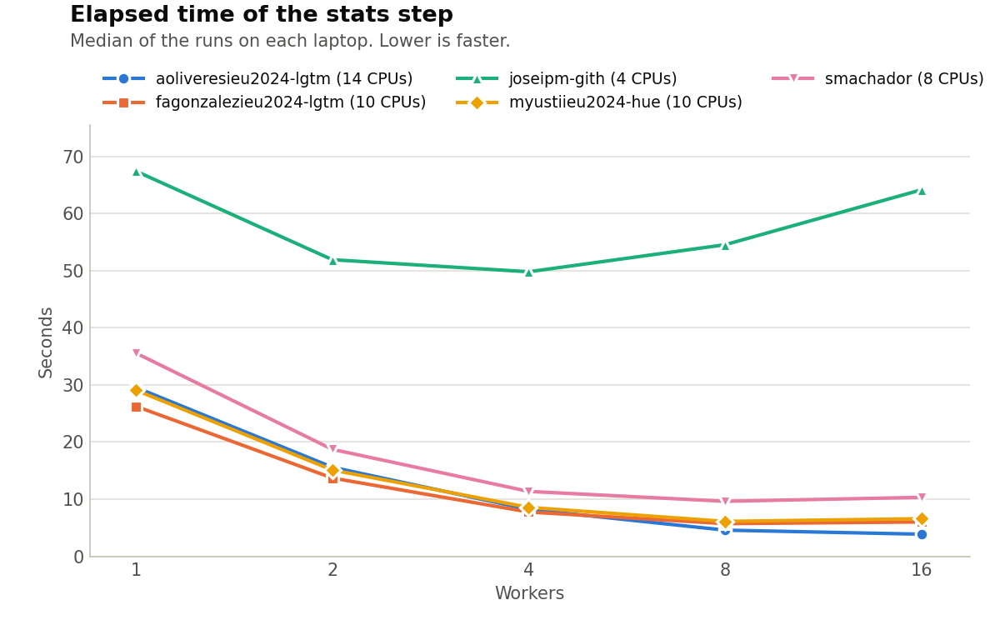

# Lab 1: The Nightly Report

Write your answers in this file. Keep them short: a few sentences, the commands
you used, and the numbers you measured. Copy the lines of output that matter,
not whole screens.

## Warm-up: Generating the report

- What happened, and why: `./run_report.sh` failed with `bash: ./run_report.sh: /bin/bash: bad interpreter: Permission denied`. `ls -l run_report.sh` showed `-rw-r--r--`: the execute permission (`x`) was missing for the owner, the group and everyone else. `bash run_report.sh` works because bash only needs to read the script.
- Your fix, and how it reached your teammates: `chmod +x run_report.sh` fixes it. smachador committed the mode change (`100644 => 100755`, commit cea1a4e) and I received it with `git pull`; `ls -l` then showed `-rwxr-xr-x`.

## Task 1: Generating the report… again

- Symptom: `./run_report.sh` finished without `revenue_by_region_month.csv`. Run alone, `python3 steps/report.py` printed `report: loaded 8,400,000 orders (887 MiB)`, then `Killed`, and `echo $?` gave 137. `run_report.sh` carried on and printed "Nightly report finished".
- Commands and recordings you used, why you chose them, and what they showed: echo $?` gave 137 = 128 + 9, so SIGKILL. `cat /sys/fs/cgroup/memory.events` showed `oom_kill 2`, and `memory.max` is 2147483648 (2 GiB), so the kernel's out-of-memory killer ended it. I timed `report.py` on the first 1, 2 and 4 million orders with `/usr/bin/time`: peak memory 507,096, 857,196 and 1,569,204 KB, growing linearly (about 356,000 KB per million orders), so about 3 GiB for 8.4 million. With `| tee` the line `report: loaded` is missing and `${PIPESTATUS[@]}` is `137 0`: Python buffers its output when writing to a pipe, and SIGKILL gives it no chance to flush. I did not use recordings.
- Cause: the 887 MiB is printed right after `read_csv`, before the program makes more copies. It then builds `months` (12 slices that together hold every row again) and `pd.concat(months)` (another copy), so about three copies are in memory at once and the peak passes the 2 GiB limit. Second fault: `run_report.sh` had no `set -e`, so it ignored the killed step.
- Fix: in `steps/report.py`, group `orders` directly, with no `months` and no `concat` (commit 79d8ed6). In `run_report.sh`, add `set -euo pipefail` (commit eaab7f9).
- Before and after (your measurements): before, killed at about 2,085,000 KB peak, exit 137, output missing. After, 7.63 s elapsed, 8.06 s user, 0.54 s system, 1,872,084 KB peak, exit 0, and `tools/check.py` prints PASS for `revenue_by_region_month.csv`. `DATA=/nonexistent ./run_report.sh` now stops at `report.py` with exit status 1.

## Task 2: Extracting data

- Symptom: The extraction script initially generated six empty regional CSV files, even though it printed `extracts: done`. All six files failed `tools/check.py`.

- Commands and recordings you used, why you chose them, and what they showed: We ran `bash steps/extracts.sh` to execute the extraction and `python3 tools/check.py` to verify the output. The checker showed that all six files contained zero rows instead of the expected number of orders. We inspected `steps/extracts.sh` to identify the problem. After fixing the script, we ran the same commands to confirm the correction. We also used `/usr/bin/time -f "$T" bash steps/extracts.sh` to measure execution time and memory usage.

- Cause: The script changed its working directory and then used an incorrect relative path (`../data/sales_2025.csv`) to read the dataset. The `2>/dev/null` redirection hid the error from `grep`. Without `pipefail`, the script could still exit successfully because the final command in the pipeline succeeded.

- Fix: We changed `steps/extracts.sh` to use the `DATA` variable for the input file and the `OUT` variable for the output directory. We also added `set -euo pipefail` and removed `2>/dev/null` so errors would no longer be hidden. The fix was committed as `e3c816b`.

- Before and after (your measurements):

  | Metric | Before | After |
  |---|---|---|
  | Elapsed time | 1.05 s | 13.23 s |
  | User CPU time | 0.05 s | 8.70 s |
  | System CPU time | 1.02 s | 11.15 s |
  | Peak memory | 7,896 KB | 7,772 KB |
  | Output | Six empty files | Six correct files |
  | `tools/check.py` | FAIL | PASS |

  After the fix, all six regional CSV files contained the expected number of rows and passed validation. Measurements were taken on Jose's MacBook Pro (2017).

## Task 3: Auditing

- Symptom: 'steps/audit.py' wrote a correct 'audit_2025.csv', but slowly: 41.16seconds elapsed on the full file, 11.51 seconds of it in the kernel, for a step that only multiplies 2 columns and writes one line per order. 
- Commands and recordings you used, why you chose them, and what they showed: '/usr/bin/time -f "$T", on the sample on the full file, to see where the time goes: 30.43 seconds user and 11.51 seconds system, so about 27% of the CPU time was spent in the kernel ('report.py' after its fix: 0.54 seconds of 8.60 seconds, about 6%). Then 'strace -c -e trace = openat, write, close' on the 100,000- order sample, to count the system calls: 100,686 'openat', 100,001 'write' and 100,673 'close', one of each per order (the extra ~680 opens and closes from Python starting up). I did not use recordings.
- Cause: The loop opened the file in append mode, wrote one line and closed it again for every order: 3 systems calls per order, about 25 million on the whole file. The comment says this saves each line on disk, but it does not: 'close()' only hands the data to the kernel's page cache, which writes it to disk later; only 'fsync()' forces it to disk. With a single open file, Python's 128 KiB buffer needs about 180,634,390 / 131,072 ≈ 1,380 'write' calls instead of 8.4 milliion
- Fix: open the file once with 'w' and run the loop inside the 'with' block: removed 'open(path, "w". close()' and the wrong comment (commit 008eb01).
- Before and after (your measurements): Full file 41.16s elapsed, 30.43 user, 11.51s system, 634,872 KB peak, after 9.56 seconds elapsed, 9.99 seconds user, 0.35 seconds system, 634,744 KB peak: about 4x faster with 33x less system, time. On the sample, trace when from 301,360 calls to 1376 (686 'openat', 17 'write', 673 'close', almost all from Pythons start up). `tools/check.py prints PASS for `audit_2025.csv` (8,400,000 lines).

## Task 4: Segmenting the orders

- Symptom:
- Commands and recordings you used, why you chose them, and what they showed:
- Cause:
- Fix:
- Before and after (your measurements):

## Task 5: Computing the statistics

- Symptom:
- Commands and recordings you used, why you chose them, and what they showed:
- Cause:
- Fix:
- Before and after (your measurements):

## The worker experiment

Every member runs `tools/sweep.sh` on their own laptop. Then run
`python3 tools/plot_sweep.py` and commit `results/sweep.png`.

- How does the elapsed time change with the number of workers on each laptop?
- Why do the curves of your laptops differ? Use the cores and threads of each
  laptop, listed in `TEAM.md`.
- Which default number of workers did you choose for `stats.sh`, and why?

## Use of generative AI

Follow the format in the syllabus: quote any generated text and name the tool
and the prompts; add the same note as a comment before any generated code. If
you did not use GenAI, write: "No content generated by AI technologies has been
used in this assignment."

### aoliveresieu2024-lgtm

Tool: Claude (Anthropic), claude.ai chat, 27 Oct to 2 Nov 2026.

- Code: the `groupby` block in `steps/report.py` and the line `set -euo pipefail` in `run_report.sh` were generated by Claude and are marked with a comment before the code. Prompts (paraphrased): I shared the code and outputs of `report.py` and asked how to fix its memory use; I shared `run_report.sh` and asked how to make it stop when a step fails. I ran both, measured them and checked them with `tools/check.py`.
- Text: the Warm-up and Task 1 sections above were drafted by Claude from the command outputs I pasted.
- Explanations: Claude explained the outputs (exit status 137, `memory.events`, `strace -c`) and helped me answer the in-class questions. I ran every command on my own laptop, and the numbers come from my terminal.
- Where it needed correcting: its first example for `machine.txt` was a placeholder that did not match my laptop, so I fixed it with my real model and macOS version. It also first overlooked smachador's execute-permission fix, which was already in the repository history.

### joseipm-gith

Tool: ChatGPT (OpenAI), chatgpt.com, 2 Nov 2026.

- Code: The modifications to `steps/extracts.sh`, including the `DATA` and `OUT` variables and `set -euo pipefail`, were suggested by ChatGPT and tested by me.

- Text: The Task 2 section was drafted with ChatGPT using my actual command outputs and measurements.

- Explanations: ChatGPT helped me understand the incorrect file path, error suppression, `pipefail`, and the before-and-after performance results.

- Where it needed correcting: The original performance measurements were initially missing. I recovered the previous code using Git, measured it myself, and updated the results.

- Prompts used: "Help me with Section 6 and identify what has already been fixed", "Help me complete Task 2", and "Is there any way to get the measurements before fixing the code?"

### myustiieu2024-hue

Tool: Claude (Anthropic), claude.ai chat, 30 October to 2 Nov 2026.

- Code: The fixed loop in `steps/audit.py` (opening the file once, with the loop inside the `with` block) was suggested by Claude and is marked with a comment before the code. Prompts (paraphrased): I shared the code of `audit.py` and the outputs of `/usr/bin/time` and `strace -c`, and asked how to diagnose and fix it. I typed the change myself in nano, measured it with `/usr/bin/time` and `strace -c`, and checked it with `tools/check.py`.

- Text: The Task 3 section above was drafted by Claude from the command outputs I pasted, but I checked every number against my terminal.

- Explanations: Claude explained the output (system call counts, user versus system time, page cache versus `fsync`, Python's 128 KiB buffer, and my worker sweep). I ran every command on my own laptop, and the numbers came from my terminal.

- Where it needed correcting: It first expected `./run_report.sh` to fail as in the guide, but my teammates had already fixed it, so we checked `git log` to see which faults were already fixed.

### fagonzalezieu2024-lgtm

Tool: Claude (Anthropic), Claude app with access to my laptop, 2 Nov 2026.

- Code: the scripts `lab1_part5.sh` and `lab1_alejandro.sh` (kept outside the repository, in my `work` folder) were generated by Claude and carry a comment saying so. They run the commands of Section 5 of the handout on the original, unfixed steps of the template, then `tools/machine_info.sh` and `tools/sweep.sh`. Prompt (paraphrased): "help me do part 5 of the Lab 1 handout and upload it to the group repository".
- Text: the short answers in `members/fagonzalezieu2024-lgtm/measurements.md` were written by Claude. Every number in that file is output from my own laptop's container (MacBook Pro 14-inch M5), filled in automatically by the script.
- Chart: Claude ran `tools/plot_sweep.py` to draw `results/sweep.png` with all five sweeps.
- Where it needed correcting: my first runs failed because Docker Desktop was not running and because I pasted the container commands into the Mac terminal.
